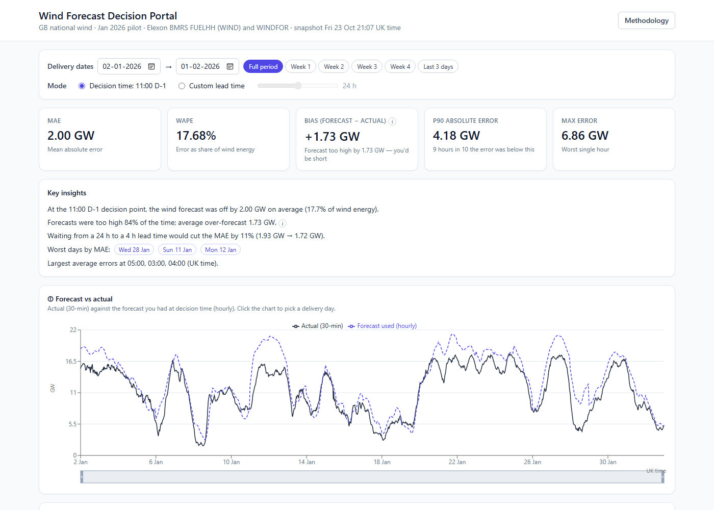

# Wind Forecast Decision Portal

A web app for a UK energy utility's **day-ahead power-buying team**. It shows the latest national
wind-generation forecast that was available when the team had to commit to tomorrow's purchases
(11:00 UK time on D-1), and measures, quantitatively, how accurate those forecasts were in
January 2026.

**Live app:** https://windportal-kjhwr-1dbe5a49eece.herokuapp.com



Full page: [docs/img/dashboard.png](docs/img/dashboard.png)

## What it does

The brief gives the trading team two goals. This is how the app answers each.

1. **"Clearly understand the latest forecast available when decisions are made."**
   For every delivery day D, the app selects the latest `WINDFOR` forecast published at or before
   11:00 Europe/London on D-1 (GB day-ahead gate closure) and plots it against what actually
   happened (`FUELHH` wind). A "custom lead time" mode (0-48 h slider) instead uses, for each target
   time _t_, the latest forecast published at or before _t - h_, to explore how accuracy changes as
   the forecast gets fresher. A forecast published after the decision time is never used.
2. **"Evaluate the accuracy quantitatively."** KPI tiles (MAE, WAPE, bias, P90 and max error),
   an error time series, error by hour of day, an error histogram, a per-day table, an accuracy
   vs lead-time curve, and an 80 % "typical error range" band on the delivery-day panel that a
   trader can use to size a safety margin.

## Key findings (January 2026)

Decision-time forecast (11:00 D-1) over the 31 delivery days (2-Jan to 1-Feb), 744 hourly points:

| MAE | RMSE | Bias (forecast - actual) | WAPE | P90 abs. error | Max abs. error |
|---|---|---|---|---|---|
| 1,995.6 MW | 2,498.8 MW | **+1,728.0 MW** | 17.68 % | 4,183.9 MW | 6,857 MW |

- **The forecast was systematically too high.** It over-forecast in 84 % of hours (27 of 31 days
  had positive average error), by 1.73 GW on average. Left uncorrected, that means systematic
  under-buying. A possible explanation, **to be verified with the client**, is that `FUELHH`
  reports metered output _after_ curtailment (e.g. Scottish transmission constraints in high-wind
  periods) while `WINDFOR` forecasts _unconstrained_ availability.
- **Fresher forecasts help, but modestly.** MAE falls from 1,932 MW at a 24 h lead time to
  1,719 MW at 4 h (-11.0 %), and is 1,680 MW at 0 h. At 48 h it is 2,301 MW. The bias persists at
  every horizon (+1.47 GW at 0 h).
- **Worst days:** Wed 28 Jan (MAE 5.33 GW), Sun 11 Jan (4.95 GW), Mon 12 Jan (4.91 GW).
  The largest average errors are in the early morning (03:00-05:00 UK time, about 2.4 GW).

These numbers are reproduced by `backend/tests/analytics/test_reference.py` against numbers computed
independently from the raw data.

## How to run

### Docker (recommended)

```bash
docker build -t windportal .
docker run -p 8000:8000 -e PORT=8000 windportal
# open http://localhost:8000
```

### Local development

Backend (Python 3.11+; CI and Docker use 3.12):

```bash
cd backend
python -m venv .venv && source .venv/bin/activate     # Windows: .venv\Scripts\activate
pip install -e ".[dev]"
uvicorn app.main:app --reload --port 8000              # API docs at http://localhost:8000/docs
```

Frontend (Node 20+), in a second terminal:

```bash
cd frontend
npm install
npm run dev                                            # http://localhost:5173, proxies /api to :8000
```

Or both at once with `docker compose up` (then open http://localhost:5173).

### Refresh the data

The repository ships with a committed Parquet **snapshot** (fetched 2026-10-23), so the app starts
with no network access. To re-fetch live from Elexon and rewrite the snapshot:

```bash
cd backend && python -m app.data.ingest        # or: make ingest
```

On a running server, `POST /api/admin/refresh` with header `X-Admin-Token: <ADMIN_TOKEN>` re-fetches
into memory (the endpoint is disabled unless `ADMIN_TOKEN` is set; a failed refresh keeps the old data).

### Tests and linting

```bash
cd backend  && pytest && ruff check . && ruff format --check . && mypy app tests
cd frontend && npm test && npm run lint && npm run format:check
```

`make test` and `make lint` run the same checks. CI (GitHub Actions) runs them on every push and also
builds the Docker image.

## Files and directories

```
.
├── README.md                    this file
├── CLAUDE.md                    instructions given to the AI coding agent (see AI usage)
├── docs/                        the specification files used to build the app; img/ = screenshots
├── Dockerfile                   multi-stage: builds the React app, serves it from FastAPI
├── heroku.yml                   Heroku container-stack build definition
├── docker-compose.yml           local dev: API with reload + Vite dev server
├── Makefile                     dev, test, lint, ingest, docker-build, docker-run shortcuts
├── .github/workflows/ci.yml     CI: backend, frontend, docker
│
├── backend/
│   ├── pyproject.toml           dependencies and ruff / mypy / pytest config
│   ├── snapshot/                committed data snapshot (actuals, forecasts, metadata JSON)
│   ├── app/
│   │   ├── main.py              app factory: routers, error mapping, SPA serving, lifespan
│   │   ├── core/                settings + domain constants (period, cutoff, tz), logging, errors
│   │   ├── data/                everything that touches external data or disk:
│   │   │                        Elexon client (retries, 7-day chunks), transform, validation,
│   │   │                        snapshot store, ingest CLI
│   │   ├── analytics/           PURE functions (DataFrames in, results out): period, selection
│   │   │                        (the leakage rule), alignment, metrics, horizon curve, bands
│   │   ├── services/            AnalysisService (store + analytics + LRU cache), refresh service
│   │   └── api/                 HTTP only: query parsing, schemas, thin routes
│   └── tests/                   mirrors app/; includes the reference-number acceptance test
│
└── frontend/
    └── src/
        ├── api/                 fetch client (typed ApiError), endpoint functions, response types
        ├── hooks/               one TanStack Query hook per endpoint
        ├── state/               URL-synced dashboard filters
        ├── features/            one folder per dashboard section (header, controls, kpis,
        │                        timeseries, day-decision, horizon, patterns, daily-table)
        ├── components/ui/       generic building blocks (Card, Skeleton, ErrorState, ...)
        └── lib/                 formatting (MW/GW, London time), chart theme, constants
```

## Architecture

```
            ┌────────────────── Docker image (Heroku web dyno) ──────────────────┐
Browser ──► │ FastAPI (uvicorn, $PORT)                                            │
            │  ├── /api/*   JSON analytics endpoints                              │
            │  └── /*       built React app (SPA fallback to index.html)          │
            │ SnapshotStore: pandas frames loaded at startup from snapshot/*.parquet │
            │  ▲                                                                  │
            │  └── refresh: Elexon client → validate → atomic swap                │
            └───────────────────────────────────────────┬─────────────────────────┘
                                                        │ only on refresh / ingest
                                                        ▼
                                          data.elexon.co.uk/bmrs/api/v1
```

One process, one container, no database server (about 20k forecast rows and 1.6k actual rows fit
comfortably in memory). Backend dependency direction: `api → services → analytics`,
`services → data`; `analytics` has no I/O and no FastAPI import, so every function is deterministic
and unit-tested. All timestamps are UTC in storage and in the API; Europe/London is used only to
compute the D-1 11:00 cutoff and for display.

| Endpoint | Purpose |
|---|---|
| `GET /api/health`, `GET /api/meta` | liveness; period, row counts, snapshot time |
| `GET /api/series` | half-hourly actuals with the selected hourly forecast and error |
| `GET /api/metrics` | summary KPIs, by-hour, by-day, error histogram |
| `GET /api/horizon-curve` | accuracy for lead times 0-48 h, with coverage |
| `GET /api/day?date=` | delivery-day decision panel with the 80 % error band and totals |
| `POST /api/admin/refresh` | token-protected live re-fetch (memory only) |

Query parameters: `start`, `end` (delivery days, clamped to the period), `mode` (`cutoff` |
`horizon`), `horizon_h` (0-48). Interactive docs are served at `/docs`.

## Methodology and assumptions

- **Decision time.** Default: latest forecast with `publishTime <= 11:00 Europe/London on D-1`. All
  hours of a delivery day therefore come from one forecast run (in January, always the 09:30 UTC run,
  lead times 14.5-37.5 h). The cutoff is computed through `Europe/London`, so it stays correct
  across the clock change (tested for 2026-03-29).
- **No look-ahead leakage.** A forecast is used only if it was published at or before the decision
  time. This is enforced by unit tests on synthetic and real data, in both modes and at
  h in {0, 1, 12, 24, 36, 48}.
- **Alignment.** `WINDFOR` is hourly and `FUELHH` is half-hourly. Forecasts are compared with actuals
  at the forecast's hourly timestamps; half-hourly actuals at :30 are plotted but excluded from metrics.
  Forecast rows with `startTime < publishTime` are dropped. Missing forecasts are excluded, never zero-filled.
- **Error sign.** error = forecast - actual. Positive means the forecast was too high, so a buyer
  would have under-procured.
- **WAPE, not MAPE.** Percentage error = Σ|error| / Σactual; MAPE blows up in low-wind hours.
  Daily energy (MWh) is approximated from hourly points.
- **Error band.** The delivery-day band is the P10-P90 of past signed errors for the same lead-time
  bucket, applied to the forecast and clipped at zero. It is **in-sample** (calibrated on the same
  month it is drawn on), so it flatters out-of-sample performance.
- **Period.** Decisions made in January 2026, i.e. delivery days 2026-01-02 to 2026-02-01 (UK local).
- **Data notes.** Elexon's documentation pages are JS-rendered and the `from`/`to` parameters of
  `WINDFOR` are silently ignored; the client uses `publishDateTimeFrom/To`. The snapshot holds
  1,632 actual rows and 20,440 forecast rows (280 runs, 8 per day) covering 2025-12-29 to 2026-02-01
  publish times.

## Limitations and next steps

- Replace the in-sample band by an out-of-sample one (errors from days before D only).
- Test the curtailment hypothesis by adding constraint/curtailment data.
- Add solar and demand; weight errors by imbalance prices to get a cost of forecast error.
- Daily live feed with scheduled refresh and alerts when the forecast diverges from actuals.
- Only the national aggregate is used; regional forecast skill may differ.

## Deploy to Heroku

Container stack, single web dyno:

```bash
heroku login
heroku create <anonymous-app-name>
heroku stack:set container -a <anonymous-app-name>
heroku config:set ADMIN_TOKEN=<random> -a <anonymous-app-name>   # optional: enables /api/admin/refresh
git push heroku main
heroku open -a <anonymous-app-name>
```

An Eco dyno sleeps after 30 minutes idle (about 10 s cold start), so open the app once before use.

## AI usage disclosure

This project was built with AI assistance: **Claude Code** (Claude Opus 5.5 for requirements
analysis, data verification and specs; Claude Sonnet 5.5 for implementation). All code was
reviewed, tested and run by me. The specs in `docs/` and `CLAUDE.md` are the prompts/instructions
used.
