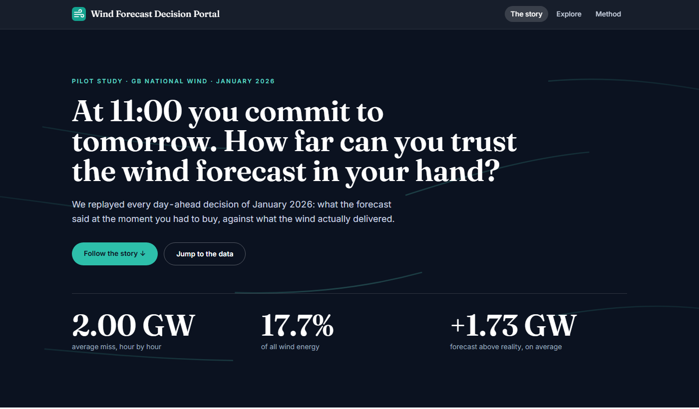
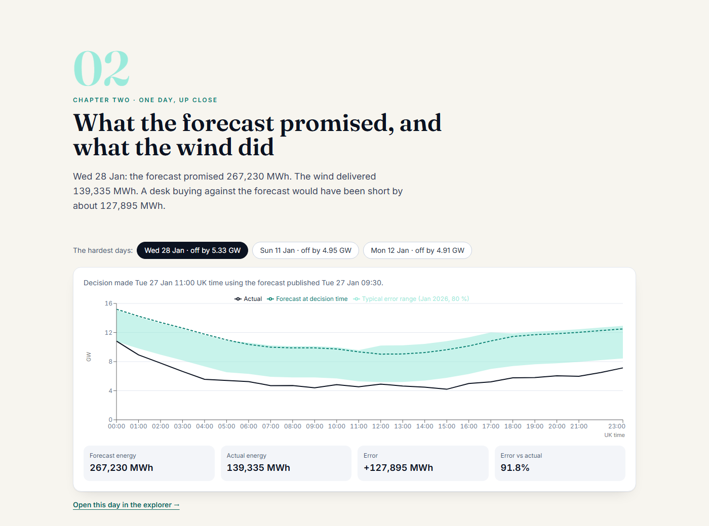
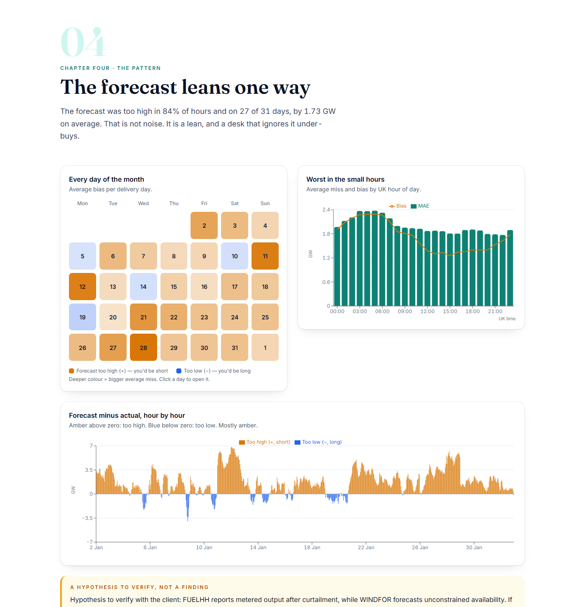
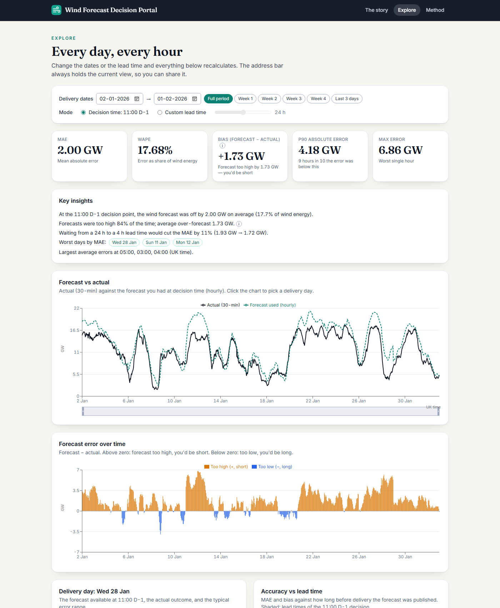

# Wind Forecast Decision Portal

**How reliable is the wind forecast that GB power buyers actually have in hand when they commit to tomorrow's electricity?**

This project replays every day-ahead purchasing decision of January 2026 against what the wind really did. It selects, for each delivery day, the latest national wind forecast that existed at the moment the day-ahead auction closed (11:00 UK time the day before), compares it with metered generation, and presents the result as a short scrolling story plus an interactive explorer.

**Live site:** https://windportal-kjhwr-1dbe5a49eece.herokuapp.com

[](https://windportal-kjhwr-1dbe5a49eece.herokuapp.com)

---

## Contents

1. [The problem](#the-problem)
2. [What the portal shows](#what-the-portal-shows)
3. [What it found](#what-it-found)
4. [How the numbers are produced](#how-the-numbers-are-produced)
5. [Architecture](#architecture)
6. [Repository layout](#repository-layout)
7. [Running it](#running-it)
8. [Configuration and deployment](#configuration-and-deployment)
9. [Testing and quality](#testing-and-quality)
10. [Limitations and next steps](#limitations-and-next-steps)
11. [AI usage disclosure](#ai-usage-disclosure)
12. [Data and attribution](#data-and-attribution)

---

## The problem

A UK energy utility has to buy the electricity its customers will use. The cheapest place to do that for tomorrow is the **GB day-ahead market**, and its auction **closes at 11:00 UK time on the day before delivery**. At that moment the buying team must decide how much *additional* power to purchase (for example from gas plants) beyond what wind will supply.

Wind output cannot be known in advance, so the team relies on a **forecast**. If the forecast is too high, they under-buy and are left exposed to expensive imbalance (cash-out) prices or last-minute top-ups. If it is too low, they over-buy and sell the surplus back at a discount. So two questions matter:

1. **What was the latest wind forecast available at decision time?** (Not the best forecast made later, which the team could not have used.)
2. **How accurate were such forecasts, in numbers a trader can act on?**

This portal answers both, using only public national-level data from Elexon's BMRS (actual wind generation and wind forecasts).

## What the portal shows

The site has three pages.

### The story (`/`)

A scrolling narrative in six chapters. Every figure in the text is computed from the data, not typed in.

| Chapter | What it explains |
|---|---|
| **1. The decision** | The three moments that define a purchase: the forecast you can use, gate closure at 11:00, and the delivery day it covers. |
| **2. One day, up close** | A single delivery day: what the forecast promised against what the wind delivered, with the typical error range shaded. Pick any of the hardest days. |
| **3. The whole month** | All 744 hourly decisions, the headline accuracy numbers, and how big the misses were. |
| **4. The pattern** | A calendar of daily bias showing the forecast leaning high, plus error by hour of day and over time. |
| **5. Does waiting help?** | Accuracy against forecast lead time, showing what a fresher forecast would have bought. |
| **6. What it means for the desk** | Plain-language implications and where to go next. |

[](https://windportal-kjhwr-1dbe5a49eece.herokuapp.com)

[](https://windportal-kjhwr-1dbe5a49eece.herokuapp.com)

### The explorer (`/explore`)

The same data as a working dashboard. Choose any date range, switch between the **11:00 D-1 decision rule** and a **custom lead time** (0-48 hours), and every chart recalculates: KPI tiles, forecast vs actual, error over time, a delivery-day panel with an 80 % error band, accuracy vs lead time, error by hour, an error histogram, and a sortable daily table. The address bar always holds the current view, so any view can be shared by link.

[](https://windportal-kjhwr-1dbe5a49eece.herokuapp.com/explore)

### The method (`/method`)

Every rule behind the numbers in plain language: the decision-time rule, how half-hourly and hourly data are aligned, the sign convention, why WAPE rather than MAPE, how the error band is built and what it cannot claim.

## What it found

Decision-time forecast (latest run published by 11:00 UK time on the day before), 31 delivery days (2 Jan to 1 Feb 2026), 744 hourly points:

| Mean absolute error | RMSE | Bias (forecast − actual) | WAPE | P90 absolute error | Worst hour |
|---|---|---|---|---|---|
| **1,995.6 MW** | 2,498.8 MW | **+1,728.0 MW** | **17.68 %** | 4,183.9 MW | 6,857 MW |

- **The forecast leaned high.** It was above actual generation in 84 % of hours and on 27 of 31 days, by 1.73 GW on average. A buyer who took it at face value would have systematically under-bought. A *hypothesis*, not a finding: Elexon's actuals (`FUELHH`) are metered output after curtailment (for example Scottish transmission constraints in windy periods), while the forecast (`WINDFOR`) describes unconstrained wind availability.
- **Fresher forecasts help, modestly.** Average error falls from 1,932 MW at a 24 h lead time to 1,719 MW at 4 h (−11.0 %), and 1,680 MW at 0 h. The bias persists at every lead time (+1.47 GW even at 0 h).
- **Errors are not evenly spread.** The hardest days were 28 Jan (MAE 5.33 GW; the forecast promised 267 GWh and the wind delivered 139 GWh), 11 Jan (4.95 GW) and 12 Jan (4.91 GW). The largest average errors fall in the early morning, 03:00 to 05:00 UK time (about 2.4 GW).
- **A margin to plan with.** Eight hours in ten, actual wind landed between 4.18 GW below and 0.50 GW above the forecast.

These are one month of national data: a pilot, not a verdict.

## How the numbers are produced

### Choosing the forecast (the core rule)

Forecasts are published several times a day (about eight runs), and each run covers roughly the next 66 hours. The portal must not use information that did not exist yet, so for each target hour:

```
Decision-time mode (default)
  cutoff = 11:00 Europe/London on the day before the delivery day
  use    = the forecast for that hour with the latest publishTime <= cutoff

Custom lead-time mode (h = 0 … 48 hours)
  use    = the forecast for that hour with the latest publishTime <= (target hour − h)
```

Consequences worth knowing:

- All 24 hours of a delivery day come from **one forecast run** (in January always the 09:30 UTC run, 14.5 to 37.5 hours ahead of the hours it covers), exactly as the buying team experiences it: one decision per day.
- A forecast published after the cutoff is **never** used. This "no look-ahead leakage" rule is the most important correctness property of the project and is enforced by unit tests on synthetic fixtures and on the real data.
- The cutoff is computed through the `Europe/London` time zone, so it stays correct across the clock change (tested for 29 March 2026) even though January itself has no daylight saving.

### Measuring accuracy

| Term | Definition |
|---|---|
| **Error** | forecast − actual. Positive = forecast too high = the buyer would be short. |
| **MAE / RMSE** | mean absolute error / root-mean-square error, in MW. |
| **Bias** | mean of the signed error. |
| **WAPE** | Σ\|error\| ÷ Σ actual: error as a share of wind energy. Used instead of MAPE, which explodes in low-wind hours. |
| **P90 absolute error** | nine hours in ten, the error was below this. |
| **Error band (80 %)** | for a given lead time, the actual wind landed between `forecast − P90(error)` and `forecast − P10(error)`, using errors from the selected range (clipped at zero). It is *in-sample*: calibrated on the same month it is drawn over. |

Alignment: forecasts are hourly and actuals are half-hourly, so accuracy is measured at the forecast's hourly timestamps; the half-hourly actuals at :30 are plotted but excluded from metrics. Forecast rows whose target time precedes their publish time are dropped, and a missing forecast excludes the hour (it is never treated as zero).

### Data quirks handled

- Elexon's documentation pages are JavaScript-rendered; the real API lives at `data.elexon.co.uk/bmrs/api/v1`.
- The `WINDFOR` stream silently ignores `from`/`to`; the working parameters are `publishDateTimeFrom` and `publishDateTimeTo`.
- Requests are chunked into 7-day windows with retries and exponential backoff, then de-duplicated.
- Ingest **fails closed**: a fetch is rejected if fewer than 95 % of the expected half-hours are present, if any delivery day has no usable forecast run, or if any value is missing or outside 0 to 30,000 MW. The previous data stays in place.

## Architecture

```
            ┌────────────────── Docker image (one web process) ──────────────────┐
Browser ──► │ FastAPI (uvicorn)                                                    │
            │  ├── /api/*   JSON analytics endpoints                               │
            │  └── /*       built React app (client-side routes fall back to index) │
            │ SnapshotStore: pandas frames loaded at start-up from Parquet files   │
            │  ▲                                                                   │
            │  └── refresh: Elexon client → validate → atomic swap                 │
            └────────────────────────────────────────────┬─────────────────────────┘
                                                         │ only on refresh / ingest
                                                         ▼
                                           data.elexon.co.uk/bmrs/api/v1
```

- **One process, one container, no database server.** The working set is about 20,000 forecast rows and 1,600 actual rows, so pandas in memory is ample.
- **Snapshot first.** A Parquet snapshot of the January 2026 data is committed, so the app starts with no network access. A protected endpoint (or the ingest command) can re-fetch live; a failed refresh keeps serving the old data.
- **Strict layering (backend).** `api → services → analytics`, and `services → data`. The `analytics` package is pure (DataFrames in, results out: no I/O, no web framework), so every rule is deterministic and unit-tested. Routes are thin; only `data/` touches the network or disk; only `services/` combines the store with analytics and owns caching.
- **Frontend.** React + TypeScript (strict). Pages compose features; features are presentational and never import each other; only `api/client.ts` calls `fetch`; colours and number formatting live in one place each. The backend computes every metric: the frontend only formats and draws.
- **Time.** All timestamps are UTC in storage and in the API. Europe/London is used only for the 11:00 cutoff and for display.

| Stack | |
|---|---|
| Backend | Python 3.12, FastAPI, pandas, pyarrow, httpx, pydantic v2 |
| Frontend | React 18, TypeScript, Vite, Tailwind CSS, Recharts, TanStack Query, React Router, date-fns |
| Quality | pytest, vitest + Testing Library, ruff, mypy (strict), eslint, prettier |
| Delivery | Multi-stage Dockerfile, GitHub Actions CI, Heroku container stack |

### API

| Endpoint | Purpose |
|---|---|
| `GET /api/health`, `GET /api/meta` | Liveness; analysis period, row counts, snapshot time |
| `GET /api/series` | Half-hourly actuals with the selected hourly forecast and error |
| `GET /api/metrics` | Summary metrics, by-hour, by-day and error histogram |
| `GET /api/horizon-curve` | Accuracy for every lead time from 0 to 48 h, with coverage |
| `GET /api/day?date=` | One delivery day: forecast, actual, 80 % band and energy totals |
| `POST /api/admin/refresh` | Token-protected live re-fetch (disabled unless `ADMIN_TOKEN` is set) |

Common query parameters: `start`, `end` (delivery days, clamped to the period), `mode` (`cutoff` or `horizon`) and `horizon_h` (0-48). Invalid input returns `422`. Interactive OpenAPI docs are served at `/docs`.

## Repository layout

```
.
├── README.md
├── CLAUDE.md                  Instructions given to the AI coding agent (see AI usage)
├── docs/                      The specification the app was built from (01-07); img/ = screenshots
├── Dockerfile                 Multi-stage: builds the React app, serves it from FastAPI
├── heroku.yml                 Heroku container-stack build definition
├── docker-compose.yml         Local development: API with reload + Vite dev server
├── Makefile                   Shortcuts: dev, test, lint, ingest, docker build/run
├── .github/workflows/ci.yml   CI: backend, frontend, docker build
│
├── backend/
│   ├── pyproject.toml         Dependencies and ruff / mypy / pytest configuration
│   ├── snapshot/              Committed data snapshot (actuals, forecasts, metadata)
│   ├── app/
│   │   ├── main.py            App factory: routers, error mapping, static site, lifespan
│   │   ├── core/              Settings, domain constants (period, cutoff, time zone), logging, errors
│   │   ├── data/              All external I/O: Elexon client, transform, validation, store, ingest CLI
│   │   ├── analytics/         Pure functions: period, selection, alignment, metrics, horizon curve, bands
│   │   ├── services/          AnalysisService (store + analytics + LRU cache), refresh service
│   │   └── api/               HTTP only: query parsing, response schemas, thin routes
│   └── tests/                 Mirrors app/; includes the reference-number acceptance test
│
└── frontend/
    └── src/
        ├── pages/             Story, Explore, Method pages; story/ holds one component per chapter
        ├── features/          Presentational sections: layout, story, controls, kpis, timeseries,
        │                      day-decision, horizon, patterns, daily-table, method
        ├── components/ui/     Generic building blocks (Card, Chapter, Reveal, CountUp, QueryState, …)
        ├── api/               Typed fetch client, endpoint functions, response types
        ├── hooks/             One TanStack Query hook per endpoint, plus UI hooks
        ├── state/             URL-synced explorer filters
        └── lib/               Formatting (MW/GW, London time), chart theme, constants
```

## Running it

### With Docker

```bash
docker build -t windportal .
docker run -p 8000:8000 -e PORT=8000 windportal
# open http://localhost:8000
```

### For development

Backend (Python 3.11 or newer; Docker and CI use 3.12):

```bash
cd backend
python -m venv .venv && source .venv/bin/activate     # Windows: .venv\Scripts\activate
pip install -e ".[dev]"
uvicorn app.main:app --reload --port 8000              # API docs: http://localhost:8000/docs
```

Frontend (Node 20 or newer), in a second terminal:

```bash
cd frontend
npm install
npm run dev                                            # http://localhost:5173, proxies /api to :8000
```

Or run both with `docker compose up` and open http://localhost:5173.

### Refreshing the data

The committed snapshot was fetched on 23 Oct 2026. To re-fetch live from Elexon and rewrite it:

```bash
cd backend && python -m app.data.ingest        # or: make ingest
```

On a running server, `POST /api/admin/refresh` with the header `X-Admin-Token: <ADMIN_TOKEN>` re-fetches into memory only.

## Configuration and deployment

| Variable | Default | Purpose |
|---|---|---|
| `PORT` | `8000` | Port to listen on (injected by most hosts) |
| `ADMIN_TOKEN` | unset | Enables `POST /api/admin/refresh` when set |
| `SNAPSHOT_DIR` | `backend/snapshot` | Location of the Parquet snapshot |
| `CORS_ORIGINS` | `http://localhost:5173` | Development only; production is same-origin |
| `LOG_LEVEL` | `INFO` | Logging verbosity |

The Docker image is self-contained and runs as a non-root user. The live site runs that image on **Heroku's container stack** (`heroku.yml` points at the Dockerfile) on a single always-on Basic dyno. Any host that runs a container and provides `PORT` will work the same way.

## Testing and quality

```bash
cd backend  && pytest && ruff check . && ruff format --check . && mypy app tests
cd frontend && npm test && npm run lint && npm run format:check
```

`make test` and `make lint` run the same checks, and GitHub Actions runs them on every push, then builds the Docker image.

- **74 backend tests** cover the data layer (transform, validation, retrying chunked HTTP client), every analytics rule (including the no-leakage guarantee for both selection modes, the clock-change cutoff, missing forecasts and error bands) and every API endpoint (shapes, validation errors, caching headers, token-protected refresh and failed-refresh behaviour).
- **An acceptance test reproduces independently computed reference numbers** (decision-time MAE 1,995.6 MW, bias +1,728.0 MW, WAPE 17.68 %, and the horizon-mode rows for 0, 4, 12, 24, 36 and 48 hours) from the real snapshot, to within 0.5 MW.
- **44 frontend tests** cover formatting (including a daylight-saving date), the typed API error, URL-synced filters, KPI wording for positive and negative bias, the story's derived facts, the calendar view, motion fallbacks and routing.

## Limitations and next steps

- **One month, national level, wind only.** No regional detail, other fuels, demand or prices, and no claim that January's behaviour holds in other seasons.
- **The error band is in-sample.** An out-of-sample version (using only errors from days before the one shown) is the natural next step.
- **The curtailment explanation is untested.** Adding constraint or curtailment data would confirm or reject it.
- **Errors are measured in MW, not money.** Weighting by imbalance prices would give the cost of forecast error.
- **Static snapshot.** A scheduled live feed with alerts when forecasts diverge from actuals would make this operational.
- **No bias correction is applied.** The portal quantifies the lean; it deliberately does not forecast.

## AI usage disclosure

This project was built with AI assistance: **Claude Code** (Claude Opus 5.5 for requirements analysis, data verification and specs; Claude Sonnet 5.5 for implementation). All code was reviewed, tested and run by the author. The specifications in `docs/` and `CLAUDE.md` are the instructions that were used.

## Data and attribution

Actual generation comes from Elexon's **FUELHH** dataset (fuel type `WIND`) and forecasts from the **WINDFOR** dataset, both via the public BMRS API. Please see Elexon's terms of use for the data. This project is an independent analysis and is not affiliated with or endorsed by Elexon.
